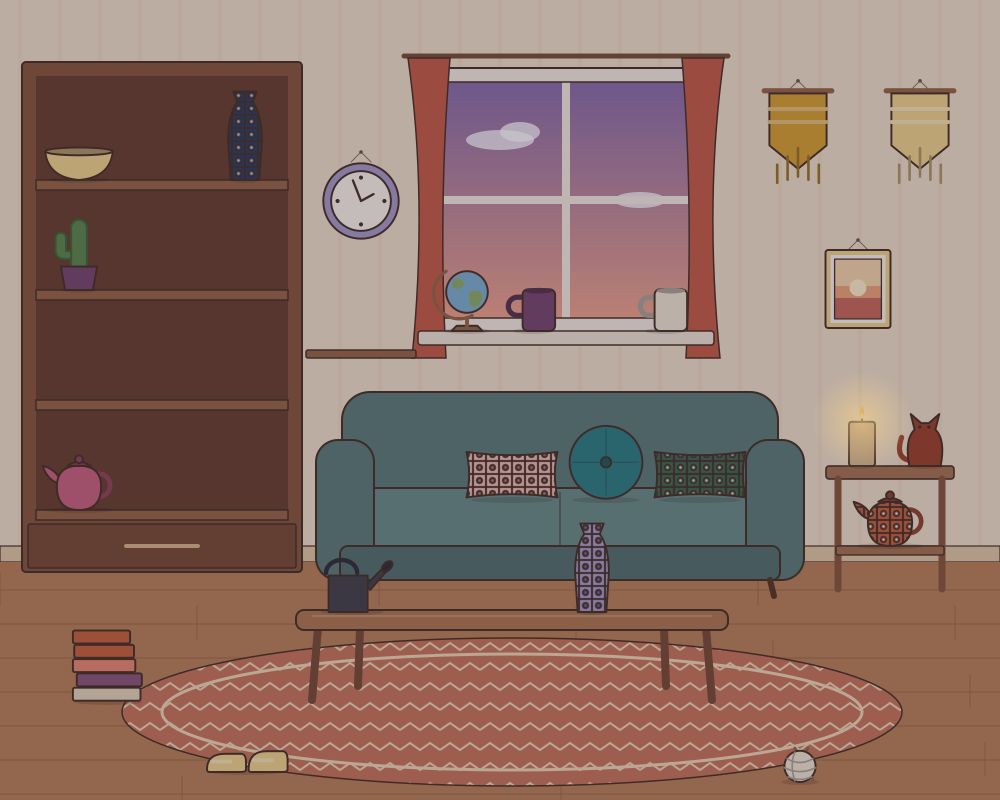

# Afterimage

**Play it: https://afterimage-room.vercel.app**

**Status: Playable v1.0.** The full game loop, all seven kinds of change, scoring, a saved high score, generated lounge music and sound effects all work. Only early play-testing so far.

Afterimage is a change-blindness game set in one cozy living room. You study the room for a few seconds. It blinks. When it opens its eyes again, something is different: a lamp has moved, a mug has changed colour, a book is gone or a new plant has appeared. Tap the change.

It sounds easy. It isn't: your brain keeps much less of a scene than it feels like it does, and the blink wipes out the motion cue that would normally give the change away.



## How to play

1. **Study** the room while the bar at the bottom runs down.
2. The room **blinks** (eyelids close and open). Something has changed.
3. **Tap the change.** Moves count at both the old and the new spot. A wrong tap costs 3 seconds. If the timer runs out you lose a heart and the game rings what you missed. **Show before** flips between the two versions so you can see it.
4. **Look again** replays the original room once more, but halves that round's points.

You have three hearts. Every fifth room cleared gives one back (up to three). Press **M**, or use the speaker button, to mute.

### The seven kinds of change

| Change | Example |
| --- | --- |
| Moved | The mug moved from the coffee table to the window sill |
| Gone | The fern on the bookcase disappeared |
| New | A jar candle appeared on the side table |
| Colour | The pillow changed from mustard to sage |
| Pattern | The pouf went from plain to zigzag (or a picture shows different art) |
| Swapped | The mug became a teacup, in the same colour |
| Turned | The teapot now faces the other way, or a picture hangs crooked |

### Scoring

- Each change found is worth `100 × (1 + 0.15 × (round − 1))` points, so 100 in round 1 and 250 in round 11.
- Time bonus: 10 points per whole second left.
- Perfect streak: each earlier perfect room in a row (no wrong taps, no peeks) adds ×0.1, up to ×2.
- Each **Look again** halves the round's total.
- The best score and the round it reached are saved in your browser (`localStorage`).

### How difficulty scales

| | Round 1 | Round 5 | Round 10 | Round 15+ |
| --- | --- | --- | --- | --- |
| Objects in the room | 5 | 11 | 19 | 26 (capped at 30 by round 18) |
| Floor in play | no (opens at round 4) | yes | yes | yes |
| Study time | 6.0 s | 5.1 s | 4.1 s | 3.0 s |
| Changes per round | 1 | 1 | 2 | 3 (from round 13) |
| Smallest item that can change | large only | medium | small | small and flat items too |
| Colour changes | very different colours | | | close shades |
| Shortest move | across the room | | | the next shelf spot |

Early rounds lean towards moved, gone and new items. Later rounds lean towards colour, pattern, swaps and turns. Rotations only start at round 3. The window light also drifts from day to golden hour, dusk and night as rounds go by, and lamps and candles glow in the dark.

## How it works

- **The room** (`src/layout.ts`) is one fixed living room with 39 slots on 8 surfaces: a four-shelf bookcase, a little wall shelf, the window sill, four couch cushions, three wall spots, a side table (top, second top spot and lower shelf), a coffee table and five floor spots. Each slot has a size budget and a list of item categories that make sense there. Slot footprints never overlap, so items never overlap.
- **The catalog** (`src/catalog.ts`) holds 56 hand-drawn SVG item kinds: mugs, teacups, candles, lanterns, vases, plants, books, magazines, remotes, glasses, bowls, figurines, clocks, teapots, radios, cameras, a globe, pillows, framed pictures (five artworks), mirrors, wall hangings, a guitar, floor lamps, baskets, poufs, slippers and more. They come in 20 named colours and up to five patterns, so rooms don't repeat.
- **Change generation** (`src/changes.ts`) picks a change type by difficulty weight and applies it to a copy of the room. Fairness rules decide what counts as visible: a minimum item size (scaled by how much of the item the colour or pattern actually covers), a minimum CIE76 colour difference, a minimum move distance, and a minimum tilt of 9°. Multiple changes never touch the same item or slot.
- **Hit-testing** (`src/hit.ts`) works in SVG coordinates. A tap inside a target (plus a small pad) counts. A near miss within about 22 screen pixels also counts, unless it landed squarely on a different, unchanged item. So phones get as much forgiveness as desktops.
- **Music and sound** (`src/audio.ts`) are synthesised live with the Web Audio API: no audio files at all.

## Run it locally

```
npm install
npm run dev        # http://127.0.0.1:5361
npm test           # unit tests
npm run build      # type-check + production build into dist/
```

Vite and TypeScript with no framework and no runtime dependencies. About 2,000 lines of TypeScript in `src/`, plus about 300 lines of tests.

Handy URL options for testing: `?seed=12` fixes the random rooms, `?round=8` starts at a later round, `?type=color` forces the first change of every round to one type (`moved`, `removed`, `added`, `color`, `pattern`, `swapped`, `rotated`), and `?gallery` shows every item kind on one screen.

## Verification

**Automated (Vitest, 20 tests, `npm test`):**
- Catalog and layout: at least 50 unique kinds, every slot holds several kinds, every kind fits somewhere, no two slot footprints overlap, and every allowed colour, pattern and flip renders differently.
- Room generation: 300 seeded rooms across difficulties are valid (no shared slots, sizes fit, pattern and flip rules, at most two of a kind, no floor items in early rounds), deterministic per seed, varied across seeds, and always leave free slots.
- Change generation: every change type forced at rounds 1, 4, 8, 15 and 25 over 40 seeds. Only the changed items differ, each change has the right shape (a move keeps everything but the slot, a recolour keeps everything but the colour, and so on), passes the visibility rules and renders differently. Late rounds produce three independent changes, a run mixes all seven types, and colour changes get measurably subtler.
- Hit-testing: taps at every target's centre find it, both ends of a move count, taps on unchanged items miss, near misses count within tolerance, and the closest change wins.
- Scoring and difficulty: the curve is monotonic, plus points, time bonus, streak and peek maths, and high-score save/load with broken or blocked storage.

**Checked by hand in a browser** (the Chromium-based in-app browser):
- Desktop (1280×720 and about 660 px wide) and an emulated 375×812 phone.
- Each of the seven change types seen in the real UI, before and after: moved, removed, added, colour, pattern, swapped, and rotated (both a mirror flip and a crooked picture).
- The full loop: start, study, blink, a wrong tap (✕ and −3 s), Look again, a found change, the round summary, a timeout with missed rings and Show before / Show after, losing all three hearts, the game-over screen and the saved best score.
- A near-miss tap about 7 px outside a target on the phone layout counted.
- The music clock starts on the Start tap, the loop advances, and the mute button moves the master volume between 0 and 1 and is remembered after a reload.
- The live Vercel URL returns 200 and plays, checked on 2026-11-22 at desktop size and on the emulated phone (see "Deployment").

**Never tested:** real phones and touch screens, Safari and Firefox, screen readers, and real players beyond early play-testing. The agent that built it could check that the music runs but **could not listen to it**, so the mix and the feel of the music have only been judged by Zach.

## Known limitations

- On a phone in portrait the whole room is only about 340 px wide, so small items are small. The tap tolerance helps, but the game is easier on a larger screen.
- Colour and pattern changes rely on colour vision. There is no colour-blind mode.
- Night rounds dim the room a little, which makes colour changes harder. That's partly intended.
- Music starts only after you press Start, because browsers block sound until you interact with the page.
- The high score lives in your browser's localStorage. Clearing site data or switching devices resets it.
- The difficulty curve comes from Zach's early play and hasn't been tuned with real players.

## Story

Zach wanted a calm memory game built on change blindness: one cozy room, a blink, and "what changed?". He set the shape of it: one persistent room with real furniture surfaces, a big item catalog per surface so rounds never feel the same, the types of change (moved, removed, added, recoloured or re-patterned, swapped, rotated), a saved high score, difficulty that scales, and soft lounge music with a mute button.

His Foundry hub chat turned that into a brief, and an AI coding agent built, tested and deployed it in one session. Partway through, early play-testing of the in-progress build, including by Zach, found it far too hard: memorising 15 to 20 objects from round 1 is a heavy load. At his direction, round 1 now has 5 objects, the floor stays bare for the first three rounds, and the room fills up gradually.

## AI assistance and Zach's role

AI coding agents built this game. Zach directed it.

- **Zach decided** the concept (change detection in a cozy room), the furniture surfaces, a large item catalog per surface, the change types, scoring with a saved high score, scaling difficulty, lounge-style background music with a mute toggle and sound effects, that it must work on desktop and phone, and that it should ship publicly. After playing early builds he cut the starting difficulty: **5 objects in round 1, no floor items early, then a gradual ramp.**
- **The planning chat (Claude, in Zach's Foundry hub)** turned that into the build brief.
- **A Claude Code agent (Claude Opus 5.5)** wrote all the code, the SVG art, the synthesised music, the tests and this README. It checked every change type and the full loop in a browser at desktop and phone sizes, and deployed it. Its own calls included: the eyelid blink, near-miss tap tolerance, the "Look again" peek, the fairness rules for each change type, the day-to-night window cycle, and scaling every item up 1.3× after the first browser check showed them too small for phones.
- **Not yet done by Zach:** a full play-through of the later rounds and a judgment of the music mix.

## Attribution

No third-party assets. All art is hand-written SVG in the source, the favicon is hand-written SVG, and fonts are system fonts. **All music and sound effects are generated in code at runtime** (`src/audio.ts`) with the Web Audio API: an electric-piano-style FM synth, a triangle-wave bass, filtered-noise brushes and a sine "vibraphone", playing an original 8-bar progression. There are no sampled or downloaded recordings, so nothing needs a licence. The only dev dependencies are Vite, TypeScript and Vitest.

## Deployment

Hosted on Vercel at https://afterimage-room.vercel.app. Pushes to `main` auto-deploy through Vercel Git integration. Manual deploy: `vercel deploy --prod` from a linked checkout.

## License

No license. All rights reserved; source is public to read.
